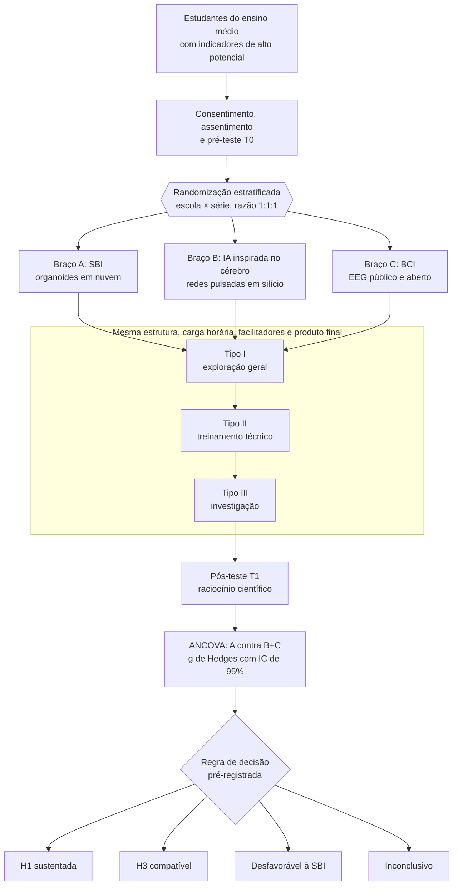
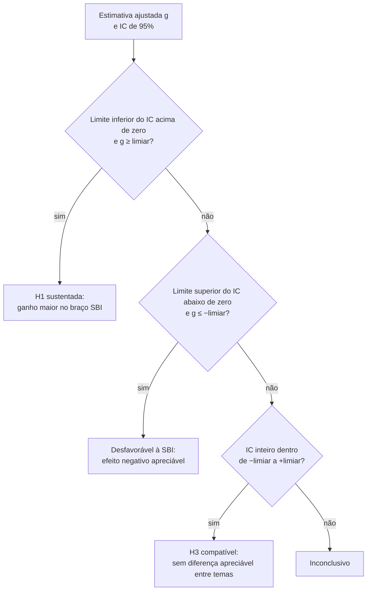
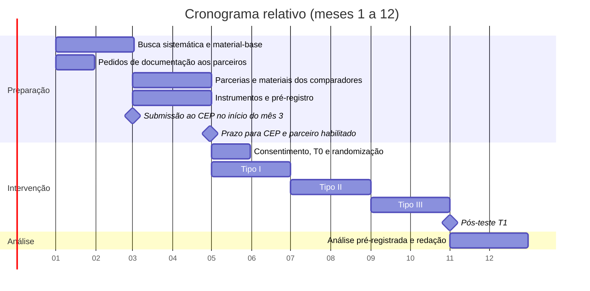
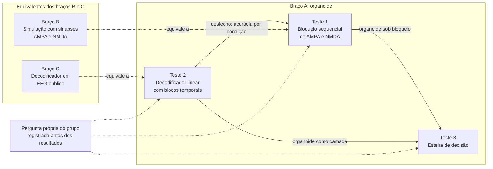
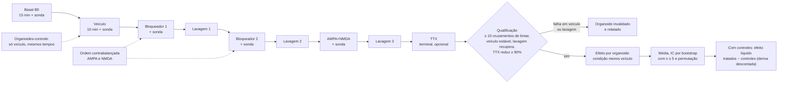
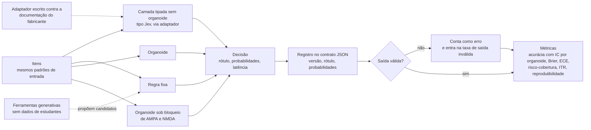
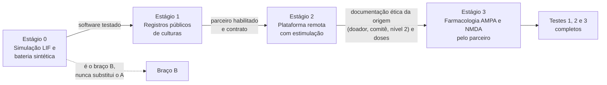
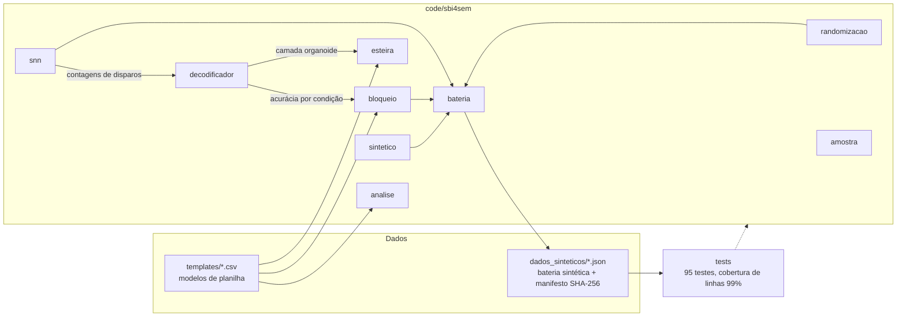

# SBI4SEM/FW: framework do protocolo de pesquisa


Material complementar do artigo **"Inteligência biológica sintética e enriquecimento escolar para estudantes com altas habilidades: revisão de literatura e protocolo experimental de um recurso de aprendizagem"**.

O artigo propõe um **piloto randomizado** que compara três temas de fronteira (SBI, IA inspirada no cérebro em silício e BCI com EEG aberto), com a mesma estrutura do Schoolwide Enrichment Model (Tipos I a III) e o raciocínio científico como desfecho primário. Este repositório reúne o que permite **executar, auditar e reproduzir** esse protocolo.

> **Status (texto idêntico em todo o repositório).** Protocolo em planejamento. Hipóteses mecanísticas não confirmadas. Código testado apenas com dados sintéticos, o que verifica a implementação, e não efeitos farmacológicos nem aprendizagem. Etapas experimentais condicionadas à habilitação de parceiros e às aprovações éticas. Não há resultados empíricos de estudantes nem de organoides. A rede simulada tem parâmetros didáticos, não ajustados a organoides. Leia [`docs/fontes_e_limites.md`](docs/fontes_e_limites.md).

*English summary:* planning materials, templates and tested Python tools (randomization, ANCOVA decision rule, blocked-temporal-validation decoders, decision-layer comparison, AMPA/NMDA blockade analysis) for a pilot comparing synthetic biological intelligence with two other frontier topics in gifted education. Synthetic data only; no empirical results. MIT license.

> **Versões do artigo.** As seções e tabelas citadas aqui seguem o **artigo** (`Artigo.docx`, seções 1 a 6, Tabelas 1 a 5). O `Resumo.docx` (596 palavras) o condensa com numeração própria (4.1 a 4.4) e não é referência de seção.

## 1. Visão geral do piloto

Os três braços percorrem a mesma estrutura (Tipos I a III do SEM), com a mesma carga horária, os mesmos facilitadores e o mesmo produto final. **Varia o tema, e não a quantidade de enriquecimento.**



## 2. Regra de decisão

Fixada **antes da coleta**, na escala do **g de Hedges** da diferença ajustada pela ANCOVA. O limiar é o menor efeito de interesse prático (valor de partida g = 0,30, a confirmar). O d = 0,30 da Tabela 4 é só parâmetro de planejamento amostral. Com amostras de piloto, o desfecho mais provável é **inconclusivo**, e o relato deve dizê-lo. Há quatro categorias: H1 sustentada, **desfavorável à SBI** (simétrica de H1: IC abaixo de zero e g ≤ −limiar; um efeito negativo claro não é "inconclusivo"), H3 compatível e inconclusivo. Implementação: `analise.decidir`.



## 3. Cronograma de 12 meses

O ano no eixo é só referência de escala: os números são os **meses do projeto**. Se a aprovação do CEP não vier a tempo, as etapas seguintes são deslocadas, e não executadas em versão reduzida.



## 4. Tarefa-padrão do braço A

Protocolo padronizado sobre a transmissão glutamatérgica, que torna o Tipo III comparável entre estudantes e entre braços ([`docs/Protocolo_AMPA_NMDA.md`](docs/Protocolo_AMPA_NMDA.md)), com hipóteses fisiológicas F1 a F5 pré-registráveis. Os testes são numerados 1, 2 e 3 para não confundir com os braços A, B e C. Cada grupo formula, dentro do protocolo, **ao menos uma pergunta própria**, registrada antes de ver os resultados.



### 4.1 Teste 1: farmacologia AMPA e NMDA

A **unidade experimental é o organoide**, e não o neurônio, o eletrodo ou a janela. A ordem de AMPA e NMDA é **contrabalançada**; organoides-controle recebem só o veículo, nos mesmos tempos. Os controles entram na análise como `grupo = "controle"`: a diferença entre tratados e controles (**efeito líquido**) separa a deriva temporal do efeito farmacológico. Doses, substâncias e tempos são definidos pelo parceiro habilitado, e a aplicação depende da documentação ética da **origem do tecido**, que é **hiPSC humana** ([decisão e fatos](docs/origem_do_tecido.md)): consentimento do doador, comitê de origem e biossegurança de nível 2, ainda não documentados. No silício (braço B), o TTX é modelado como bloqueio de canais de Na⁺ (`bloqueio_na`), e não como bloqueio de AMPA+NMDA.



Critérios em `bloqueio.qualificar_organoide`; análise em `bloqueio.analisar_bloqueio`. Com menos de 5 organoides, o resultado é descritivo e o IC não é calculado. Os limiares são valores de partida, a fixar no pré-registro.

### 4.2 Teste 3: esteira de decisão

Todas as camadas recebem **os mesmos itens**. O Jev, da TypeSafe AI, entra como camada tipada sem organoide; **o adaptador deve ser escrito contra a documentação do fabricante**, e os números do fabricante não entram como dado do estudo: latência e acurácia são medidas na própria esteira.



### 4.3 Trilha em estágios do braço A

Inspirada no roteiro do projeto OrganoidIntelligence: começar pela simulação, provar o software e só então passar ao tecido. Cada estágio tem critério de entrada; o braço A do piloto exige o estágio 3 ([`docs/trilha_em_estagios.md`](docs/trilha_em_estagios.md)).



Se um estágio não for alcançado até o fim do mês 4, a mudança vira **emenda registrada antes da randomização**.

### 4.4 Braço C e leitura crítica

- [`docs/braco_C_eeg.md`](docs/braco_C_eeg.md): conjuntos públicos de EEG e algoritmos suportados pelo MetaBCI, com divisão por sessão ou bloco e o mesmo decodificador linear dos demais braços.
- [`docs/leitura_critica.md`](docs/leitura_critica.md): atividade de neuroética que rastreia afirmações de divulgação (eficiência energética, DishBrain, preços, robôs) até a fonte primária.

## 5. Arquitetura do código e dos dados

Pacote Python `sbi4sem` (`numpy` e `scipy`). A bateria JSON é gerada por `bateria.py` a partir de sementes fixas, e os testes a consomem.



## 6. Estrutura do repositório

```
FW/
├── LICENSE                     Licença MIT
├── docs/                       Protocolo e instrumentos de gestão
│   ├── Protocolo_AMPA_NMDA.md      Tarefa-padrão do braço A (3 testes)
│   ├── preregistro_modelo.md       Modelo de pré-registro
│   ├── delineamento_e_alocacao.md  Braços, randomização, cronograma
│   ├── instrumentos_e_fidelidade.md  Desfechos, rubrica, roteiro de fidelidade
│   ├── ameacas_validade.md         Registro de ameaças e contramedidas
│   ├── governanca_e_viabilidade.md Lista de verificação ética e de viabilidade
│   ├── trilha_em_estagios.md       Estágios do braço A (simulação → farmacologia)
│   ├── origem_do_tecido.md         Decisão hiPSC humana x camundongo: preço, conceito, ética
│   ├── braco_C_eeg.md              Equivalente do Teste 2 em EEG público
│   ├── leitura_critica.md          Atividade de neuroética: evidência x promessa
│   ├── registro_de_busca.md        Modelo do diário de busca bibliográfica
│   ├── contrato_esteira.schema.json  Contrato JSON da esteira de decisão
│   └── fontes_e_limites.md         Grau de leitura das fontes e limites
├── templates/                  Planilhas CSV, dicionário de dados, formulário da pergunta do grupo
├── code/                       Pacote Python `sbi4sem`, testes e exemplos
└── dados_sinteticos/           Bateria de dados sintéticos em JSON (+ manifesto com SHA-256)
```

## 7. Mapa: artigo → framework

| Seção do artigo | Onde está no framework |
|---|---|
| 5.1 Pergunta, hipóteses, critério de decisão (quatro categorias) | `docs/preregistro_modelo.md`; `code/sbi4sem/analise.py` (`decidir`) |
| 5.2.3 Tarefa-padrão do braço A; tecido hiPSC humana | `docs/Protocolo_AMPA_NMDA.md`; `docs/origem_do_tecido.md`; `bloqueio.py`, `decodificador.py`, `esteira.py` |
| Braços B e C (equivalentes) | `snn.py` (sinapses AMPA e NMDA; TTX como bloqueio de Na⁺); decodificador em EEG público (`decodificador.py`, `docs/braco_C_eeg.md`) |
| 5.3 Delineamento e alocação | `docs/delineamento_e_alocacao.md`; `randomizacao.py` |
| 5.4 Desfechos, instrumentos, cronograma | `docs/instrumentos_e_fidelidade.md`; `templates/` |
| 5.5 Análise e tamanho amostral | `analise.py` (ANCOVA, g de Hedges; núcleo parcial: ver a seção 9); `amostra.py` (Tabela 4) |
| 5.6 Ameaças à validade | `docs/ameacas_validade.md`; `analise.fluxo`, `analise.proporcao_teto` |
| 5.7 Ética e viabilidade | `docs/governanca_e_viabilidade.md` |

## 8. Início rápido

```bash
cd code
pip install -r requirements.txt
python -m pytest                          # 95 testes
python exemplos/demo_completo.py          # fluxo completo, com dados sintéticos
python exemplos/benchmark_carga.py --saida resultado.json   # tempos de execução (seção 4.4 do artigo)
python -m sbi4sem.amostra                 # reproduz a Tabela 4 do artigo
```

Detalhes em [`code/README.md`](code/README.md); os dados sintéticos em [`dados_sinteticos/README.md`](dados_sinteticos/README.md).

## 9. O que fica de fora de propósito

- **Adaptador do Jev (TypeSafe AI).** Deve ser escrito contra a documentação do fabricante; o código aceita qualquer função que devolva probabilidades por rótulo (`CamadaTipada`).
- **Doses, substâncias e tempos da farmacologia.** Cabem ao parceiro habilitado.
- **Instrumento final do desfecho primário** e os limiares do pré-registro.
- **Partes do plano de análise do artigo ainda não codificadas** (seções 5.1, 5.3 e 5.6). `analise.py` é um **núcleo parcial**: implementa só o desfecho primário (ANCOVA, g de Hedges, regra de decisão, fluxo e atrito, casos completos). Ficam para o pré-registro, que as especifica antes de serem codificadas: imputação para a análise por intenção de tratar (hoje `ancova` recusa `t1` ausente), análise de H2 (rubrica RED na tarefa aberta e contraste A–B contra A–C), moderação pela preferência de tema e análise por protocolo como sensibilidade completa.
- **Forma de citação do repositório:** decisão em aberto dos autores.

## Papel de cada documento

Nenhum arquivo prevalece automaticamente sobre outro. Cada um tem uma função, e **qualquer divergência gera correção ou decisão versionada** (registrada em `templates/desvios_do_protocolo.csv` ou no histórico do repositório):

| Documento | Função |
|---|---|
| Artigo | Justificativa e desenho geral |
| `docs/Protocolo_AMPA_NMDA.md` e demais `docs/` | Procedimentos operacionais |
| Pré-registro (`docs/preregistro_modelo.md` preenchido) | Decisões congeladas antes dos dados |
| `code/sbi4sem/` | Implementação das regras documentadas; não cria regras próprias |

## 10. Licença

Distribuído sob a **licença MIT** (arquivo [`LICENSE`](LICENSE)), que cobre o código, os documentos, os modelos de planilha e os dados sintéticos deste repositório. A licença **não se estende** a documentação, serviços ou modelos de terceiros citados aqui (por exemplo, o Jev e as plataformas de biocomputação), que seguem seus próprios termos.
